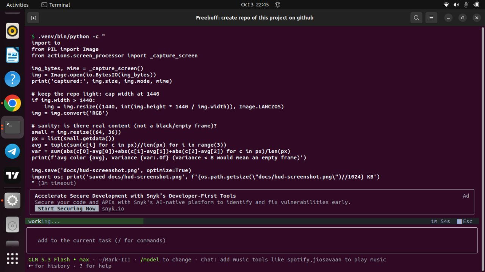

# J.A.R.V.I.S. — RIO


<p align="center">
  
</p>

**RIO** (Rajneesh / RIO) is a real-time voice assistant that hears, sees, speaks, controls your computer, **and produces finished videos** — **Windows, macOS, Linux**. Built on the **Gemini Live API** for native audio streaming, with a PyQt6 HUD that gives it a holographic face, a screen to play media on, and a phone dashboard for when you're away from the desk.

> Upstream lineage: [FatihMakes/Mark-LV](https://github.com/FatihMakes) (Mark LIII → LIV → LV). This repo continues that line — see [Credits](#credits--license) and [`CREDITS.md`](CREDITS.md).

---

## ✨ Highlights

- **It has a face** — a software-rendered holographic head with real lip-sync (~50 visemes/sec from audio formants + transcript), facial acting, and gaze that tells you what state it's in. No GPU, no extra packages.
- **Music plays inside the HUD** — *"play Kesariya on JioSaavn"* decrypts JioSaavn's CDN stream and plays it **in the assistant's own display panel**, hands-free from the first note. Pause / next / previous / *what song is this?* all work by voice. Spotify, Gaana, Wynk and Amazon Music are supported too — each through its most honest path.
- **Video plays there too** — YouTube, a local file, or any direct URL, in the same panel, muted until you ask for sound.
- **One model ladder, zero dead ends** — every Gemini call in the app routes through a measured ladder of models; a quota error, timeout or outage steps to the next rung instead of failing.
- **A phone in your pocket controls it** — the FastAPI dashboard pairs by QR code: send commands, stream your phone mic, hear replies, all over HTTPS.
- **It talks to Telegram/WhatsApp** — the Hermes bridge forwards inbound messages (and files) into the same brain, and answers come back on the channel they arrived on.
- **It makes videos** — a full video studio: narrated documentaries (research → script → visuals → voice → burned subtitles, free), vertical Shorts (1080×1920, measured caption timing), **Blender 3D animation** (an original procedural robot avatar that talks), and AI cinematic shots via configured providers — encoded with verified Intel VAAPI H.264 and automatic CPU fallback, with a mandatory approval flow before anything renders. A permanent character cast (from a design sheet) can be featured consistently across videos.
- **Knows when to be quiet** — local "Hey Jarvis" wake word (opt-in), self-echo suppression, microphone auto-muting while media plays, and a confirmation gate so the model can never confirm its own irreversible actions.

---

## 🚀 Capabilities

| Area | What it does |
|---|---|
| 🎙️ **Voice & HUD** | Gemini Live conversation in any language, wake word, push-to-talk (Ctrl+Space), 5 native voices, live theming, waveform, unlimited sessions via context compression, session resumption across reconnects |
| 🎵 **Media** | In-HUD music (JioSaavn by default — streams resolved and played internally; Gaana, Spotify, Wynk, Amazon Music, YouTube Music), in-HUD video (YouTube/local/direct URL), global media-key transport, **now-playing** via the OS media session (MPRIS / SMTC / AppleScript) |
| 🖥️ **Computer control** | Launch apps, volume/brightness/WiFi/power, file operations with undo, browser and desktop control, Android/phone control, keyboard/mouse automation, screen + webcam vision |
| 🧠 **Memory & knowledge** | Persistent memory with recall on demand, conversation journal, local RAG knowledge base (PDF/docx/text → chunked, embedded, cited answers) behind a service API with per-caller collection ACL (`config/rag_callers.json`) and REST endpoints (`/api/rag/*`), adaptive retrieval strategies (agentic/corrective/self-RAG + offline local twins) that grade evidence and hallucination risk, **self-directed web learning** that researches unanswered questions and monitored interests nightly into cited living dossiers (`docs/RAG_LEARNING.md`), clipboard intelligence (translate/summarise/explain) |
| 🔍 **Information** | Multi-mode web search (news/research/price), weather, news, flight search, morning briefing, proactive check-ins, background topic monitoring |
| 📧 **Google** | Gmail by voice — list/search/read, send, mark read, archive, trash (never a permanent delete) — and Google Calendar — list upcoming events, create, delete. The morning briefing includes tomorrow's events and the unread-mail count when connected (consent-free: never opens a login tab). One-time OAuth setup: save a Desktop-app `client_secret.json` into `config/`; the first command opens the consent tab and tokens stay local (gitignored, `JARVIS_HOME`-relocatable) |
| 📊 **Trading & data** | Bitcoin/gold/USD price levels from a local tracker, TradingAgents multi-analyst equity runs, market desk plugin, and **institutional portfolio/risk analytics** — market-regime read, beta/correlation to the book, VaR/CVaR, drawdown, risk-parity and vol-targeted sizing via `scripts/institutional_metrics.py` (`docs/INSTITUTIONAL_TRADING.md`); the `institutional-trading` skill turns a single-name idea into a sized position and an IC memo |
| 🧩 **Extensibility** | Skills are single files in `actions/` that declare a `TOOL` dict and are auto-discovered; plugins are single files in `plugins/`; Hermes skills install from a GitHub URL by voice |
| 🎬 **Video studio** | Documentary (researched, narrated, cited), Shorts (vertical, captioned), Blender 3D animation, AI cinematic via providers (paid, approval-gated) — engine registry, hardware detection (VAAPI/CUDA-honest), local TTS (Kokoro/espeak), permanent character cast, durable job store with detached workers; see `core/video_agent/` and `VIDEO_STUDIO_*.md` |
| 🔬 **Agents** | Orchestrator-routed real agents: coding agent (inspect→plan→change→test→verify, `docs/CODING_AGENT.md`), research agent (question→plan→search→collect→compare→verify→report over permitted web+KB sources with cited, uncertainty-honest reports, `docs/RESEARCH_AGENT.md`), RAG agent (`docs/RAG_STRATEGIES.md`) |
| 📱 **Remote** | QR-paired phone dashboard (HTTPS, AES-encrypted commands, phone-mic streaming), auto-start on boot, portable pendrive mode |
| 🔐 **Safety** | Confirmation buttons for irreversible actions, real undo, self-echo guard, mic auto-mute while media sounds, secrets never committed |

The full per-feature list from upstream Mark LV lives in [`docs/mark-lv-readme.md`](docs/mark-lv-readme.md).

---

## 🛠️ Requirements

- **Python 3.11+** (3.12 recommended)
- A **Gemini API key** — [Google AI Studio](https://aistudio.google.com/) (free tier works)
- OS bits: `portaudio`/ALSA audio on Linux (`sounddevice` wheels cover Win/macOS); a browser for media; `ngrok` optional for remote access

## ⚙️ Setup

```bash
git clone https://github.com/Nagendra-hash/Rio.git
cd Rio
./run.sh          # Windows: run.bat
```

`run.sh` creates `.venv`, installs the dependencies for **your OS only** (via `requirements.txt` platform markers), and launches the HUD. First launch:

1. The app asks for your **Gemini API key** and stores it in `config/api_keys.json` (gitignored — never commit it).
2. Talk. Say "what can you do", or "play some music".
3. Optional — **wake word**: ⚙ → WAKE WORD inside the app downloads the tiny local model ("Hey Jarvis").
4. Optional — **phone dashboard**: press *Remote Control* in the HUD, scan the QR, and the dashboard opens on your phone over HTTPS (port 8000).

Handy env var: `JARVIS_HOME=/some/dir` relocates **all** writable state (config, memory, knowledge, models) — this is what portable/pendrive mode uses.

---

## 🏗️ Architecture

Single-process Python app; everything local by default.

```
┌──────────────────────────── main.py ────────────────────────────┐
│  Gemini Live session · audio I/O · viseme extraction · dispatch  │
│        ▲ stream to phone            ▲ dashboard commands         │
└────────┼───────────────────────────┼──────────────────────────────┘
         │                dashboard/server.py (FastAPI :8000)
         │                QR pairing · AES-encrypted commands · ws feed
┌────────┴─────────────────────────────────────────────────────────┐
│ ui.py — PyQt6 HUD: avatar canvas · waveform · media panel         │
│   show_video / pause_video / stop_video / set_video_muted         │
└───────────────────────────────────────────────────────────────────┘
core/      gemini.py (model ladder) · llm_router.py · action_loader.py
           rag.py + rag_service.py (RAG library + ACL service — see
           docs/rag_architecture.md) · rag_learner.py (self-directed web
           learning — docs/RAG_LEARNING.md) · echo.py · wake_word.py
actions/   30+ skills, each a file with a module-level TOOL dict:
           music_player · video_player · web_search · computer_settings
           gmail_control · calendar_control · knowledge_base · hermes_task · …
plugins/   user plugins — drop a .py, auto-discovered on next launch
memory/    memory_manager · conversation_journal · config_manager
hermes-hooks/  Telegram/WhatsApp → scripts/jarvis_inbox.py → dashboard
```

**How a skill is born.** Any `actions/*.py` that declares a module-level `TOOL = {name, description, parameters, handler}` is discovered by `core/action_loader.py` at launch, validated, and offered to the model as a callable tool. Adding a capability is one file — see [`actions/music_player.py`](actions/music_player.py) for a worked example (stream resolution, per-service honesty, HUD vs browser fallbacks, offline-tested transport).

**How music reaches the HUD.** `music_player` resolves a song (JioSaavn's public site API), decrypts the DES-protected CDN stream URL, and hands the raw `audio/mp4` stream to the HUD's Qt media player through `ui.show_video(...)` — the same surface video_player uses. Transport controls go straight to the player (media keys are the fallback for external players), and `now_playing` reads either the HUD's own state or the OS media session (MPRIS on Linux, SMTC on Windows, AppleScript on macOS).

**Audio hygiene.** The HUD auto-closes the microphone while media makes sound and gives it back when it stops; JARVIS subtracts its own output from the mic (`core/echo.py`) so it never answers itself.

---

## 🧪 Tests

Offline-only pytest suite (no network, no audio device needed):

```bash
.venv/bin/python -m pytest tests/ -q
```

---

## 🔐 Security notes

- `config/api_keys.json`, device tokens, certs and session data are **gitignored**; git history has been scrubbed of all of them. Keep it that way — if you fork or re-clone, don't `git add -f` them.
- The dashboard authenticates devices with one-time QR keys over HTTPS; commands are AES-encrypted end-to-end between browser and server.

## 🤝 Contributing

Skills and plugins are single files by design — PRs that add one are the easiest way in. Please include an offline test in `tests/` for anything you add.

## 📄 Credits & License

- Upstream **MARK LV — JARVIS** by [FatihMakes](https://github.com/FatihMakes) — Copyright (c) 2026, licensed **CC BY-NC 4.0** (non-commercial). This repository continues that work; see [`LICENSE`](LICENSE).
- Upstream feature notes preserved in [`docs/mark-lv-readme.md`](docs/mark-lv-readme.md).
- Full attribution, lineage and third-party component notes: [`CREDITS.md`](CREDITS.md).
- **License status:** the inherited code remains under **CC BY-NC 4.0 (non-commercial)** — this project does not relicense upstream work.
